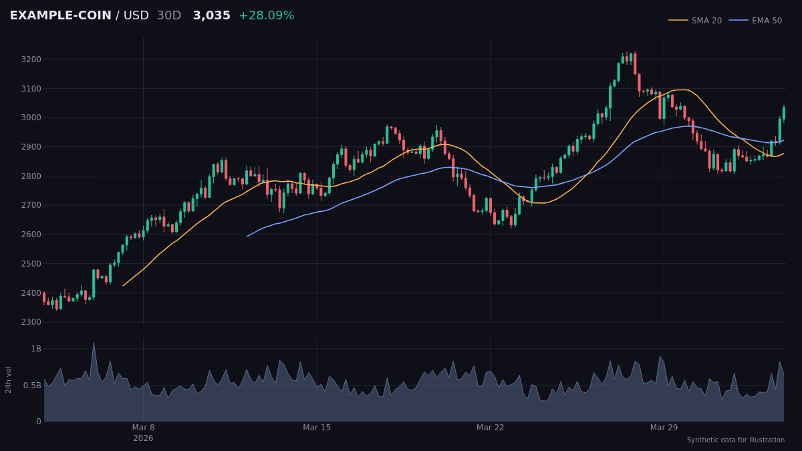
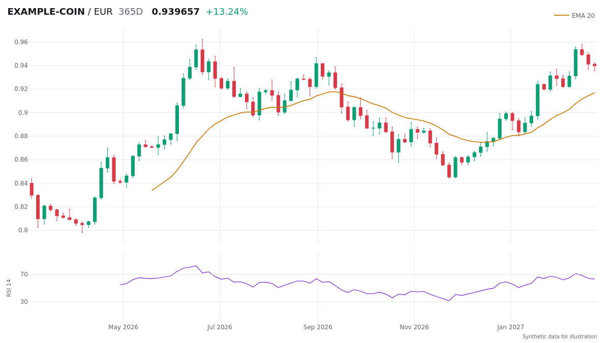

# CoinGecko chart service

[](https://github.com/VinVirtual/microservice-coingecko-chart/actions/workflows/test.yml)


[](LICENSE)

A small Flask service that renders candlestick charts as PNG or SVG from [CoinGecko](https://www.coingecko.com/en/api) market data. Ask for a coin, a range, a theme, a size and optional indicators; get an image back. Upstream calls are cached, retried and guarded by a circuit breaker, so the service stays inside CoinGecko's free-tier limits and keeps answering when the API has a bad minute.



```
GET /v1/chart?coin=ethereum&days=30&indicators=sma:20,ema:50&volume=true
```

<sub>README images are rendered from synthetic prices by `scripts/render_examples.py`, so they never go stale and need no network.</sub>



## Quick start

```bash
docker build -t coingecko-chart .
docker run --rm -p 8000:8000 coingecko-chart
curl -o btc.png "http://localhost:8000/v1/chart?coin=bitcoin&days=7"
```

Without Docker (Python 3.11+):

```bash
python -m venv .venv && . .venv/bin/activate
pip install -r requirements.txt
gunicorn -c gunicorn.conf.py chartsvc.wsgi:app        # or: python -m chartsvc  (dev server)
```

No API key is needed: without one the service uses CoinGecko's keyless public API. A free Demo key raises the limits; set `COINGECKO_API_KEY` (see [Configuration](#configuration)).

## API

The full contract is served as OpenAPI 3.1 at `GET /openapi.json`.

| Endpoint | Returns |
|---|---|
| `GET /v1/chart` | `image/png` or `image/svg+xml` |
| `GET /v1/ohlc` | the candles behind a chart, as JSON |
| `GET /health` | status, upstream circuit state, cache counters |
| `GET /openapi.json` | this API's description |

### `/v1/chart` parameters

| Parameter | Values | Default |
|---|---|---|
| `coin` | CoinGecko coin id (`bitcoin`, `ethereum`, ...) | `DEFAULT_COIN` (`bitcoin`) |
| `vs` | quote currency (`usd`, `eur`, `btc`, ...) | `usd` |
| `days` | `1`, `7`, `14`, `30`, `90`, `180`, `365` | `30` |
| `format` | `png`, `svg` | `png` |
| `theme` | `dark`, `light` | `dark` |
| `width` / `height` | 320-1600 / 240-1200 CSS px | 1200 / 675 |
| `scale` | `1`, `2` (retina) | `1` |
| `indicators` | up to 4 of `sma:N`, `ema:N` (overlays) and one `rsi:N` (panel), N = 2-200 | none |
| `volume` | `true` adds CoinGecko's rolling 24h volume panel (one extra upstream call) | `false` |

Candle size is decided by CoinGecko: 30 minutes for 1 day, 4 hours up to 30 days, 4 days beyond. An indicator that needs more candles than the range has is listed in the legend as such rather than silently missing.

`/v1/ohlc` takes `coin`, `vs` and `days` and returns `[timestamp_ms, open, high, low, close]` rows (timestamp = candle close) plus a summary.

### Responses

Images carry `X-Cache: HIT | MISS | STALE` and `X-Request-ID`. Every JSON body, including every error, uses one envelope:

```json
{
  "success": false,
  "data": null,
  "error": {
    "code": "invalid_parameter",
    "message": "'days' must be one of the values CoinGecko supports.",
    "details": {"param": "days", "allowed": [1, 7, 14, 30, 90, 180, 365]}
  },
  "meta": {"request_id": "4f0c9b2e..."}
}
```

| Status | `code` | When |
|---|---|---|
| 400 | `invalid_parameter` | unknown, repeated or out-of-range parameter (nothing is sent upstream) |
| 404 | `coin_not_found`, `no_data`, `not_found` | unknown coin, empty range, unknown path |
| 405 | `method_not_allowed` | |
| 410 | `endpoint_removed` | a 1.x endpoint (see [Changes in 2.0](#changes-in-20)) |
| 429 | `rate_limited` | per-client limit hit; `Retry-After` and `X-RateLimit-*` headers set |
| 502 | `upstream_auth` | CoinGecko rejected the configured key |
| 503 | `upstream_unavailable` | CoinGecko down or rate limiting us and nothing cached; `Retry-After` set |
| 500 | `internal_error` | a bug; details are logged, never returned |

## How it treats CoinGecko

- **Cache.** Market data is cached per `(coin, vs, days)` for `CACHE_TTL_SECONDS` (default 300 s) and rendered images for the same time, so repeated requests cost no upstream calls. Concurrent misses for the same key make a single request.
- **Timeouts and retries.** 3.05 s connect / 10 s read; connection errors, timeouts, 429 and 5xx are retried with exponential backoff (honouring `Retry-After`, capped at 5 s). 400/404 are not retried.
- **Circuit breaker.** After `BREAKER_FAILURES` consecutive failures, calls stop for `BREAKER_RESET_SECONDS`, then one trial request decides whether to close it again.
- **Stale on error.** If CoinGecko fails and an expired entry younger than `STALE_TTL_SECONDS` exists, it is served with `X-Cache: STALE` instead of an error.
- **Payload checks.** Responses over 8 MB, malformed rows, non-finite numbers or impossible candles (high below open, ...) are rejected.
- **Attribution.** Charts carry "Data: CoinGecko", as CoinGecko's free plans require.

## Security

- **No SSRF.** The host is fixed (`api.coingecko.com` or `pro-api.coingecko.com`); `coin` must match `^[a-z0-9][a-z0-9-]{0,79}$` and `vs` `^[a-z]{2,10}$` before they are used in a path; redirects are not followed. `ALLOWED_COINS` can restrict coins further.
- **Bounded work.** Image size is capped at 1600×1200 CSS px × scale 2; at most 4 indicators; rate limits per client (`RATE_LIMIT_CHART`, `RATE_LIMIT_DATA`); Kaleido calls are serialised per worker; workers are recycled every `GUNICORN_MAX_REQUESTS`.
- **No file writes.** Images live in a size-bounded in-memory LRU (`IMAGE_CACHE_MAX_MB`).
- **Headers.** `X-Content-Type-Options: nosniff`, `X-Frame-Options: DENY`, `Referrer-Policy: no-referrer`; SVG responses get `Content-Security-Policy: default-src 'none'`. CORS is off unless `CORS_ORIGINS` lists origins.
- **Errors** never echo exceptions or upstream bodies. **Secrets** come only from the environment. The container runs as UID 10001.

## Configuration

All settings are environment variables, validated at startup. See [`.env.example`](.env.example).

| Variable | Default | |
|---|---|---|
| `COINGECKO_API_KEY` | unset | Demo or Pro key; unset uses the keyless public API |
| `COINGECKO_API_PLAN` | `demo` if a key is set, else `public` | `public`, `demo` or `pro` (Pro uses `pro-api.coingecko.com`) |
| `CACHE_TTL_SECONDS` / `STALE_TTL_SECONDS` | `300` / `3600` | fresh / stale-on-error windows |
| `UPSTREAM_CONNECT_TIMEOUT` / `UPSTREAM_READ_TIMEOUT` | `3.05` / `10` | seconds |
| `UPSTREAM_RETRIES` | `2` | |
| `BREAKER_FAILURES` / `BREAKER_RESET_SECONDS` | `5` / `60` | |
| `DEFAULT_COIN` / `ALLOWED_COINS` | `bitcoin` / any | |
| `RATE_LIMIT_CHART` / `RATE_LIMIT_DATA` | `20 per minute` / `60 per minute` | per client IP |
| `RATE_LIMIT_STORAGE_URI` | `memory://` | use `redis://...` to share limits across instances |
| `TRUSTED_PROXIES` | `0` | proxies whose `X-Forwarded-For` is trusted for client IPs |
| `CORS_ORIGINS` | none | comma-separated |
| `IMAGE_CACHE_MAX_MB` | `64` | per worker |
| `WEB_CONCURRENCY` / `GUNICORN_THREADS` / `GUNICORN_TIMEOUT` | `2` / `4` / `45` | see `gunicorn.conf.py` |
| `LOG_LEVEL` | `INFO` | logs are one JSON object per line, with `request_id` |

## Deploy

- **Docker:** the image is `python:3.12-slim` with DejaVu fonts, non-root, and a `HEALTHCHECK` on `/health`. It is about 790 MB, most of it Kaleido's bundled Chromium.
- **Railway / Heroku-style:** `Procfile` and `nixpacks.toml` start `gunicorn -c gunicorn.conf.py chartsvc.wsgi:app`.

Measured locally (1 worker): a cold chart request, including the CoinGecko call and Kaleido start-up, took about 1.4 s; the same chart from cache took 3 ms.

## Development

```bash
pip install -r requirements-dev.txt
pytest --cov                              # upstream is a fake; sockets are blocked in tests
ruff check chartsvc tests scripts gunicorn.conf.py
python scripts/render_examples.py         # regenerate docs/media
```

```
chartsvc/
├── app.py          routes, error envelope, rate limits, security headers, request logs
├── validation.py   strict query parsing
├── coingecko.py    client: timeouts, retries, breaker, cache, payload validation
├── cache.py        TTL cache with stale reads; bounded image LRU
├── breaker.py      circuit breaker
├── indicators.py   SMA, EMA, RSI
├── render.py       Plotly figure + Kaleido export, themes
├── openapi.py      OpenAPI 3.1 document (tests check it matches the routes)
├── logs.py         JSON log formatter
└── config.py       environment settings
```

## Changes in 2.0

2.0 turns the original single-token chart bot into a general, stateless chart service.

- `/generate`, `/tweet`, `/multi`, `/collage` and `/individual` are gone and answer `410` with a pointer to `/v1/chart`. They uploaded every image to a public storage bucket and returned its URL; images are now returned directly, which removes the storage credentials from the service.
- Chart-pattern detection and LLM trading "signals" were removed. The signals were not reliable analysis and are out of scope for a rendering service.
- The fake volume series (computed from candle ranges) was replaced by CoinGecko's real 24h volume, opt-in with `volume=true`.
- The CoinGecko key is no longer in the source; it is read from `COINGECKO_API_KEY`.

## License

[MIT](LICENSE) © Lashvin Manimaran. Market data © CoinGecko, used under its API terms.
